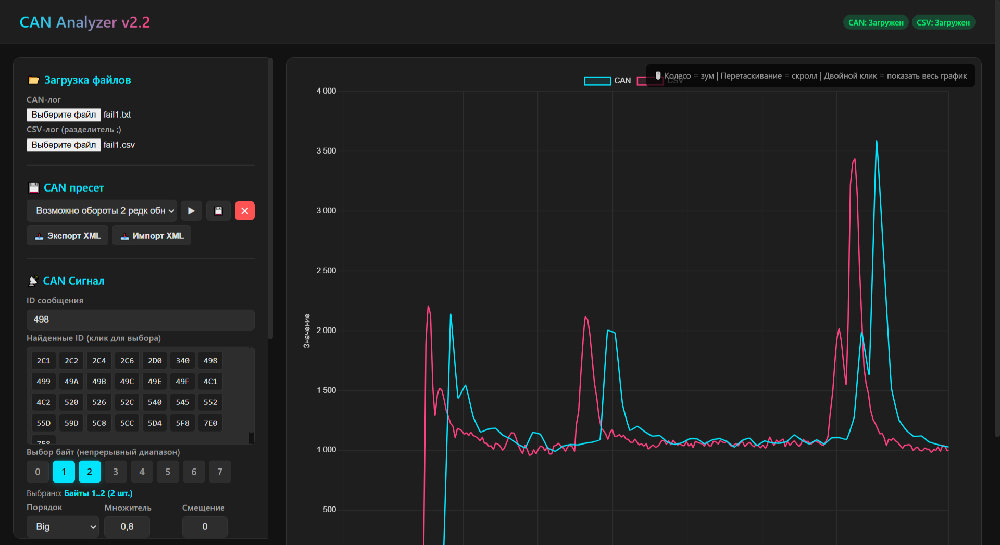

# 🚗 CAN Analyzer

**Веб-инструмент для анализа CAN-шины с визуальным сравнением данных из CAN-лога и CSV-файла.**

[](LICENSE)
[]()
[]()

> Удобный инструмент для инженеров-диагностов, тюнеров и всех, кто работает с CAN-шиной автомобиля. Работает прямо в браузере, **без установки и без интернета**.

---

## 📖 История проекта

Всё началось с одной задачи: подключить цифровую приборную панель к двигателю на кастомном транспортном средстве. Конфигурация была непростая:
- **Транспортное средство** — кастомное
- **Приборная панель** — кастомная
- **Двигатель** — заводской, с родным блоком управления (ЭБУ)

Задача — снимать все нужные показания прямо из ЭБУ по CAN-шине. На первый взгляд, два пути:

### Путь №1: Диагностические сообщения
Казалось бы, самое простое — читать стандартные диагностические PID'ы. Но у этого способа два серьёзных минуса:
- Решение «костыльное» — диагностика не предназначена для постоянного опроса с высокой частотой.
- Если понадобится подключить внешний сканер для просмотра параметров, которые я не предусмотрел для вывода на панель, возникнет конфликт.

### Путь №2: Расшифровка сырых CAN-данных
Именно так работает большинство штатных приборных панелей в современных автомобилях. ЭБУ постоянно шлёт кадры с показаниями — нужно лишь знать, в каких байтах и в каком формате лежат нужные параметры.

Так и родился этот инструмент — небольшое веб-приложение, которое помогает находить нужные сигналы в CAN-потоке, визуализировать их и сравнивать с эталонными данными из диагностического оборудования.

---

## 🔧 Тестировалось на оборудовании

Лично я использовал приложение в связке со следующим оборудованием:

| Устройство | Назначение | Формат данных |
|---|---|---|
| **[Canny](https://canny.ru/)** | Сбор логов CAN-шины | Собственный формат (табуляции, HEX) |
| **Scanmatic** | Сбор параметров двигателя | CSV с заголовками |
| **Launch** | Диагностика | CSV *(требует небольшой ручной правки)* |

> 💡 **Планы на будущее:** добавить поддержку «сырых» CSV из Launch и другого диагностического оборудования без необходимости ручной правки. Если у вас есть специфичный формат — создавайте Issue, постараюсь добавить поддержку.

---

## 📸 Скриншот



---

## ✨ Возможности

- 🌓 **Современный тёмный интерфейс** — удобно работать в любое время суток.
- 📡 **Парсинг CAN-логов** — автоматическое извлечение ID, байт и временных меток.
- 📊 **Парсинг CSV** — автоматическое чтение заголовков столбцов.
- 🔍 **Список найденных ID** — клик по ID мгновенно подставляет его в поле ввода.
- 🎯 **Умный выбор байт** — только непрерывные диапазоны (защита от случайных ошибок).
- 🧮 **Кастомные формулы** — поддержка выражений вида `(b0*256+b1)*0.25`.
- ⏱️ **Гибкая работа со временем** — время из столбца CSV или ручная периодичность.
- 🔄 **Авто-смещение времени** — синхронизация CAN и CSV по первым точкам.
- 💾 **Пресеты CAN** — сохранение настроек для разных сигналов/двигателей.
- 📤 **Экспорт/импорт пресетов в XML** — обмен с коллегами.
- 🔎 **Зум и скролл** — колесо мыши + перетаскивание, с сохранением масштаба.
- 📐 **Общая шкала Y** — удобно подбирать множитель для совпадения графиков.
- ⚡ **Авто-перестроение** — график обновляется сразу при изменении параметров.
- 🌐 **Полностью офлайн** — все библиотеки лежат локально, интернет не нужен.

---

## 🚀 Быстрый старт

1. Скачайте репозиторий (кнопка **Code → Download ZIP**) или клонируйте его:  
   `git clone https://github.com/Likus/can-analyzer.git`
2. Откройте файл `index.html` в любом современном браузере (Chrome, Firefox, Яндекс).
3. Готово! Никакой установки, никакой настройки.

> 💡 **Работает без интернета.** Все зависимости (Chart.js, Hammer.js, chartjs-plugin-zoom) лежат в папке с проектом.

---

## 📂 Поддерживаемые форматы

### CAN-лог (TXT / LOG)
Файл с разделением полей **табуляцией**.  
Пример строки:  
`0C9	CAN	7	00	00	00	0A	00	41	08		.....A.	50107	RX0`

- `ID` — идентификатор сообщения в HEX.
- `B0..B7` — байты данных в HEX (до 8 байт).
- `Timestamp` — временная метка в миллисекундах (предпоследний столбец).

### CSV-лог
Файл с разделителем `;`. Первая строка — **заголовки столбцов** (используются для выбора нужного столбца в интерфейсе).  
Пример:
`time;RPM;Speed;Throttle`  
`0;850;0;12.5`  
`100;1200;15;25.3`

> 💡 Если в CSV нет столбца времени — можно задать **ручную периодичность** (например, 10 мс между точками), и инструмент сам построит временную шкалу.

---

## 🎮 Как пользоваться

1. **Загрузка файлов:** загрузите CAN-лог и/или CSV-лог. Можно загрузить только один файл.
2. **Выбор CAN-сообщения:** введите ID вручную или кликните по нужному ID в списке. Выберите байты (только непрерывный диапазон), укажите порядок (Big/Little), множитель и смещение.
3. **Кастомная формула (опционально):** если стандартного режима недостаточно, задайте формулу, используя переменные `b0`..`b7` (например, `(b0*256+b1)*0.25`). Если формула задана, выбор байт не требуется.
4. **Работа с временем CSV:** выберите режим «Из столбца CSV» (укажите нужный столбец) или «Ручная периодичность» (задайте шаг и начальное время).
5. **Синхронизация:** нажмите **«Авто»** для расчёта смещения времени или скорректируйте множитель вручную.
6. **Работа с графиком:** колесо мыши = зум, перетаскивание = скролл, двойной клик = показать весь график. При изменении параметров масштаб по X сохраняется, по Y — автоподбор.

---

## 💾 Пресеты

Пресеты сохраняют **только CAN-настройки** (ID, байты, порядок, множитель, смещение, формула). CSV-настройки не сохраняются, так как они специфичны для каждого файла.

- **💾** — сохранить текущие настройки под именем.
- **▶** — применить выбранный пресет.
- **✕** — удалить пресет.
- **📤 Экспорт XML** — выгрузить все пресеты в файл.
- **📥 Импорт XML** — загрузить пресеты из файла.

Пресеты автоматически сохраняются в `localStorage` браузера и переживают перезагрузку страницы.

---

## 🛠️ Технологии

- **Chart.js** — построение графиков.
- **Hammer.js** — поддержка touch-жестов.
- **chartjs-plugin-zoom** — зум и панорамирование.
- **Чистый HTML/CSS/JS** — без фреймворков и сборщиков.

Все библиотеки распространяются под лицензией MIT.

---

## 📦 Структура проекта

- `CanAnalize.html` — Основной файл приложения.
- `chart.umd.min.js` — Chart.js (локально).
- `hammer.min.js` — Hammer.js (локально).
- `chartjs-plugin-zoom.min.js` — Плагин зума (локально).
- `LICENSE` — Текст лицензии MIT.
- `README.md` — Этот файл.

---

## 🤝 Вклад в проект

Баг-репорты и предложения по улучшению приветствуются!  
Особенно интересны:
- Поддержка новых форматов CAN-логов.
- Поддержка «сырых» CSV из Launch и другого диагностического оборудования.
- Новые идеи по визуализации и анализу.

Создавайте Issue или Pull Request — посмотрим вместе.
Быстрый ответ не обещаю, но по возможности буду реагировать.

---

## 📄 Лицензия

Проект распространяется под лицензией **MIT**. Подробности — в файле [LICENSE](LICENSE).

```text
MIT License
Copyright (c) 2026 Likus
```
---

## ⚠️ Отказ от ответственности

Программное обеспечение предоставляется **«как есть»**, без каких-либо гарантий.  
Автор не несёт ответственности за любой ущерб, возникший в результате использования данного ПО, включая (но не ограничиваясь) ошибки интерпретации данных CAN-шины, некорректную диагностику или любые другие последствия.

---

## 🔗 Ссылки

- **Репозиторий:** https://github.com/Likus/can-analyzer
- **Демо (GitHub Pages):** https://likus.github.io/can-analyzer/
- **Автор:** Likus

---

<p align="center">
  Сделано мною для меня
</p>